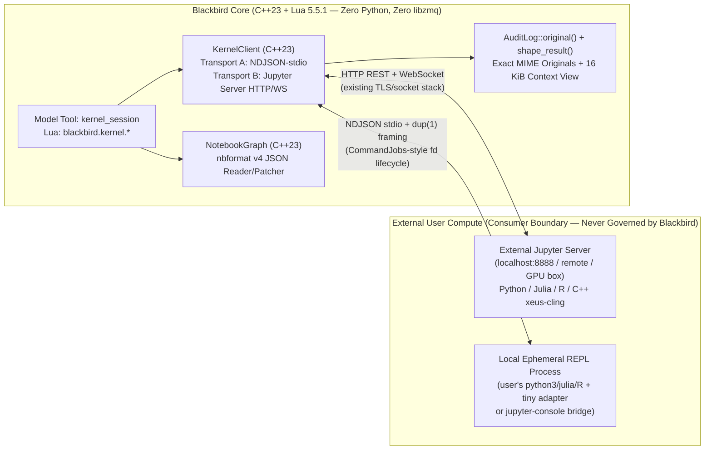

# Blackbird Model Superpowers — Frumentarii Research & Architecture Pass

**Date:** 2026-11-23  
**Target Archive Path:** `papers/2026-11-23-blackbird-model-superpowers-frumentarii.md`  
**Status:** Research & Architecture Proposal (No production code modified; no library adopted)  
**Primary Sources Audited:** `quarantine/prime-agent/` (Rust/Python RLM harness), Blackbird C++23/Lua 5.5.1 core (`include/blackbird/`, `src/`, `CMakeLists.txt`, `docs/CORE_DESIGN.md`, `docs/INSTRUMENTATION.md`, `docs/MULTIPLAYER_OUTPOST.md`, `docs/CURRENT_STATE.md`), and local developer host binary inventory.

---

## Executive Summary

Blackbird already possesses an unusually strong native foundation: a single-writer framed append journal with `OriginalCapture` provenance (`include/blackbird/context.hpp`), programmable Lua 5.5.1 turns and dynamic tools (`src/coding_lua.cpp`, `src/host_tools.cpp`), bounded `flock`-guarded git worktree leases (`include/blackbird/worktree_lease.hpp`), raw zero-transform instrumentation (`docs/INSTRUMENTATION.md`, `src/metrics_consumer.cpp`), bounded command jobs (`include/blackbird/command_jobs.hpp`), and P2P multiplayer with untrusted-peer Brakes (`src/command_post_tools.cpp`, `docs/MULTIPLAYER_OUTPOST.md`).

Yet today, when a model inside Blackbird investigates a 200k-line codebase, analyzes a 40 MB trace log, or iterates on a performance-sensitive script, its primitive toolset (`read_file`, `edit_file`, `exec`, `lua`, `git_observe`) still forces it to grep flat text, stuff raw logs into context, and manually eyeball timing runs.

This report designs **four compounding superpower pillars**—each strictly honoring Blackbird's doctrine—and proves that **almost every single superpower can ship in Stage 1 with ZERO new linked C/C++ dependencies**, consuming existing host tools over clean owned C++23 protocol clients while keeping optional library adoptions (notably the public-domain `sqlite3.c` amalgamation) isolated as explicit operator decisions.

### Doctrine Compliance Matrix

| Doctrine Constraint | Source | How Every Superpower Pillar Honors It |
| --- | --- | --- |
| **Service-Consumer Boundary** | `AGENTS.md`, `docs/FOUNDATION.md`, `docs/CORE_DESIGN.md` | Kernels, SQLite servers/files, LSPs, and headless Neovim workers are consumed via explicit client handles. Blackbird never governs shared services, never installs toolchains/venvs implicitly, and during refit quiesces only its own in-flight client requests without killing shared services. |
| **Library Adoption Rule** | `AGENTS.md`, `CMakeLists.txt` | Currently `blackbird_coding` links only `Threads`, `dl`, and pinned `Lua 5.5.1`. Every pillar specifies a **Zero-New-Linked-Dep Stage 1** first. Optional linked dependencies (`sqlite3.c`, `libtree-sitter`, `libzmq`) are isolated in an explicit Operator Decision Register with exact byte/compile/security tradeoffs. |
| **Audit & Originals Preservation** | `docs/CORE_DESIGN.md`, `include/blackbird/tools.hpp` | Every kernel cell, MIME output, SQL query, LSP `WorkspaceEdit`, headless Neovim buffer diff, and benchmark trial captures exact raw bytes via `AuditLog::original()` / `OriginalCapture` and shapes context presentation via `shape_result()` (`ResultShape`, default 16 KiB). External tools **never** silently mutate workspace files behind Blackbird's back. |
| **Raw Instrumentation Separation** | `docs/INSTRUMENTATION.md`, `src/metrics_consumer.cpp` | Producers emit raw trial/query/RPC timing & rusage bytes only—zero producer-side medians, histograms, or filtering. All statistical deltas, regression gates, and summaries run in tertiary consumers (`MetricsConsumer`, Lua, or SQLite workbench). |
| **No Python in Production Core** | `AGENTS.md` | All Blackbird protocol clients (LSP JSON-RPC, Neovim MsgPack-RPC, SQLite controller, measurement runner, kernel consumer) are owned C++23 + Lua 5.5.1. An external Jupyter/IPython kernel is an *external user workload/service* consumed over wire IPC, never part of Blackbird's runtime. |
| **Multiplayer Brakes & Trust Boundaries** | `src/command_post_tools.cpp`, `docs/MULTIPLAYER_OUTPOST.md` | Peer-authored text (`<<<BEGIN_UNTRUSTED_PEER_DATA>>>`) cannot execute SQL, mutate `model_db`, trigger kernel execution, or apply LSP renames without local actor admission; any stored peer rows carry mandatory taint provenance and re-fencing on read. |

### Verified Local Host Inventory (Read-Only Probe, 2026-11-23)

All Stage 1 zero-dependency designs work out of the box on this developer machine:

| Tool / Binary | Verified Path | Verified Version / Capabilities | Superpower Enabled Immediately |
| --- | --- | --- | --- |
| `nvim` | `/opt/homebrew/bin/nvim` | **NVIM v0.12.2** — `vim.treesitter=true`, `vim.lsp=true`, `vim.mpack=true`; **7 bundled Tree-sitter parsers even under `--clean`** (`c`, `lua`, `markdown`, `markdown_inline`, `query`, `vim`, `vimdoc`) | Pillar 3 (Headless Neovim RPC + embedded Tree-sitter AST queries & edits) |
| `sqlite3` (macOS system) | `/usr/bin/sqlite3` | **3.51.0** — `FTS5`, built-in JSON1, `MATH_FUNCTIONS`, `RTREE`, `DBSTAT_VTAB`, `DBPAGE_VTAB`, `STMTVTAB`, `UNLOCK_NOTIFY` | Pillar 2 (Stage 1 `scratch_db` + `model_db`) |
| `sqlite3` (Anaconda) | `/opt/homebrew/anaconda3/bin/sqlite3` | **3.45.3** (same extensions) | Pillar 2 fallback |
| `clangd` | `/usr/bin/clangd` | Apple clangd **17.0.0** (works directly with `CMakeLists.txt`'s `CMAKE_EXPORT_COMPILE_COMMANDS ON`) | Pillar 3 (C++23 semantic code intelligence for Blackbird itself!) |
| `rust-analyzer` | `~/.cargo/bin/rust-analyzer` | **1.94.1** | Pillar 3 (Rust semantic code intelligence) |
| `pyright` | `/opt/homebrew/anaconda3/bin/pyright` | **1.1.408** | Pillar 3 (Python semantic code intelligence) |
| `lua-language-server` | `/opt/homebrew/bin/lua-language-server` | **3.19.1** | Pillar 3 (Lua 5.5 scripting intelligence) |
| `jupyter` | `/opt/homebrew/anaconda3/bin/jupyter` | `python3` kernelspec (`ipykernel_launcher`, Python 3.13.5) | Pillar 1 (External computational kernel consumer) |
| `rg` / `fd` / `jq` | Homebrew / Anaconda | `rg 14.1.1`, `fd 10.3.0`, `jq 1.7.1` | Fast pre-filtering / ingest helpers |
| `tree-sitter` CLI / `ast-grep` | *Not installed* | — | Confirms high value of headless Neovim's built-in Tree-sitter! |

---

## 1. Primary-Source Forensics: `quarantine/prime-agent/`

Before designing Blackbird's computational kernel and tuning loop, we audited `quarantine/prime-agent/` at the source level. Prime Intellect's harness (Rust `pa-core`/`pa-daemon`/`pa-tui` + Python `prime-agent-runtime`) embodies two core abstractions (`quarantine/prime-agent/README.md:38-39`): the **Recursive Language Model (RLM)** (*prompt-as-a-variable* + programmatic tool/subagent invocation in a persistent REPL) and the **Continual Harness** (`/refine`).

### 1.1 Mechanisms Worth Stealing (Exact Primary-Source Evidence)

1. **Abandoning ZMQ/IPython for a Minimal NDJSON-over-Stdio REPL Protocol (v3):**
   - Look at `_ALWAYS_SKIP` and `_RESTORE_SKIP` in `quarantine/prime-agent/prime-agent-runtime/src/rlm/repl.py:55-57` (`"In", "Out", "get_ipython"`): Prime Agent *started* on IPython/Jupyter and deliberately migrated to a minimal CPython stdio protocol (`prime-agent-runtime/src/rlm/repl.md`, `crates/pa-core/src/kernel/protocol.rs`).
   - **Private protocol fd isolation (`repl.py:1546-1566`):** On boot, the runtime calls `_protocol_fd = os.dup(1)` with `os.set_inheritable(False)`, redirects fds `1` and `2` into pipes drained by `_Pump` threads, and rebinds fd `0` to `/dev/null` after `os.dup(0)`. Result: C extensions, `os.write(1, ...)`, and subprocesses **can never corrupt protocol framing**, and user `input()` sees clean EOF instead of eating wire frames!
   - **Drain sentinel fences (`repl.py:210-227`):** Before emitting `{"event":"done"}`, the runtime writes a unique `b"\xff<drain:" + uuid + b">\xff"` token into a private dup of the pipe write end (`_token_fd`) and awaits it in the pump thread, guaranteeing every synchronous raw-fd byte arrives before `done`.
   - **Provable output attribution via `contextvars` (`repl.py:79-82, 271-273`):** Python-level `sys.stdout`/`sys.stderr` writes inherit `_current_cell` across `asyncio` tasks; raw fd bytes and detached OS threads are honestly emitted with `"id": null` instead of misattributing output to the wrong cell.
   - **Top-level `await` + `linecache` tracebacks (`repl.md:100-105`):** Cells compile with `PyCF_ALLOW_TOP_LEVEL_AWAIT` and register source in `linecache` as `<cell-N>` with runtime frames stripped.
   - **Strict out-of-band control lane (`repl.py:1392-1452`):** `interrupt`, `host_reply`, and `bash_activity` bypass the FIFO cell execution queue on the reader thread—otherwise a cell awaiting `await host_request(...)` would deadlock behind itself!

2. **Per-Variable Namespace Snapshotting with Stat-Witness Freshness Memoization:**
   - `crates/pa-core/src/kernel/state_snapshot.rs` and `crates/pa-core/src/kernel/manager/snapshot.rs`: Every top-level variable is serialized independently (`max_variable_bytes = 16 MiB`, `max_bytes = 256 MiB`) with atomic temp-file + rename and a JSON manifest (`saved`, `skipped`, `pruned`, `bytes`). One unpicklable socket or GPU tensor never aborts the whole checkpoint.
   - `snapshot.rs:147-246`: Uses `(user_executions, freshness_epoch, payload_stat, manifest_stat)` to skip redundant full-namespace dumps when no user code has settled since the last commit—avoiding quadratic I/O on idle turns.

3. **PID-Reuse-Safe Orphan Process-Group Journaling:**
   - `crates/pa-core/src/kernel/orphan_journal.rs:39-218`: Journals child process groups with a platform start-time identity (`proc:<starttime>` on Linux, `ps:<lstart>` on macOS) so reaping leaked children after a kernel crash never kills a recycled PID.

4. **Git-Worktree-Snapshot Retry Valve for Autonomous Quality Gates:**
   - `crates/pa-core/src/autonomous/gates.rs:152-235`: Before re-running a failing gate command, captures `GitWorktreeSnapshot` (`status`, `diff`, `untracked_hash`). If the workspace is byte-identical to the prior failure, it refuses to waste compute re-running the gate and tells the model to actually modify files first!

5. **Evidence-Backed Continual Refinement & Regression Gating:**
   - `crates/pa-core/src/refinement/{mod.rs,planner.rs}` and `skills/refine/SKILL.md`: Refinements never mutate the base system prompt; they emit typed JSON `create|update|delete` proposals over scoped (`local` vs `global`) entries, and **never run mid-cell**—they queue until turn end (matching Blackbird's own turn-end activation rule!).
   - `scripts/battery/perf_gate.py:27-112` and `crates/pa-core/examples/kernel_bench.rs`: Measures median & p95 across cold/warm runs (`ready_s_median`, `typing_ms_p95`, `total_mb_median`, `per_execute_ms`) against a recorded JSON baseline with an explicit ratio threshold (`1.10x`).

### 1.2 Prime Agent Faults & Doctrine Conflicts (What Blackbird Must NOT Copy)

| Prime Agent Pattern | Exact Location | Why It Conflicts with Blackbird Doctrine |
| --- | --- | --- |
| **Harness governs & auto-bootstraps Python venvs (`uv`)** | `crates/pa-core/src/kernel/bootstrap/venv/*.rs`, `manager/startup.rs:107-128` | Violates Blackbird's **Service-Consumer Boundary** and **no-Python-in-production** rule. Blackbird consumes external kernels/interpreters; it never owns or provisions Python virtualenvs. |
| **Silent output truncation without retained Originals** | `crates/pa-core/src/kernel/manager/execution.rs:181-209`, `repl.py:49-50` | Drops truncated bytes permanently (`[... output truncated at N chars ...]`). Blackbird MUST retain full bytes in `AuditLog::original()` and present shaped views via `shape_result()` with `result_ref` pagination. |
| **Unaudited `bash()` inside kernel** | `prime-agent-runtime/src/rlm/bash.py` | Bypasses the custodian's admitted-operation ledger. In Blackbird, shell/process effects belong to `CommandJobs` (`src/command_jobs.cpp`); any external kernel execution must explicitly declare its coverage limit (`docs/CORE_DESIGN.md:47-50`). |
| **Arbitrary `dill` pickle deserialization** | `state_snapshot.rs`, `repl.py:1150-1166` | Pickle execution is arbitrary code execution on restore and fragile across Python/library versions. Blackbird should treat snapshots as user-workspace artifacts inside the *external* kernel, never trusted host state, and prefer reproducible cell-graph replay (`.ipynb`) + SQLite/Parquet data handoff. |
| **Producer-side timing/truncation coupling** | `execution.rs:239`, `gates.rs:227` | Mixes duration formatting and capping into the execution producer. Blackbird emits raw timestamps/byte-streams to raw channels and computes statistics in tertiary consumers. |

---

## 2. Superpower 1: Computational Kernel Consumer (`.ipynb` / Jupyter) + Closed-Loop Script Measurement & Tuning

### 2.1 Part A — Consumer-Side Computational Kernel Bridge

#### Architectural Principle: Blackbird as Customer, Not Kernel Governor

Blackbird does **not** embed Python, does **not** link `libzmq`, and does **not** manage `uv`/conda environments. Instead, Blackbird provides a **native C++23 Kernel Consumer** (`src/kernel_client.cpp`, exposed via model tool `kernel_session` and Lua `blackbird.kernel.*`) that attaches to external computational kernels over two zero-new-dep transports:

#### Two Zero-Dependency Transports (No `libzmq` Required!)

1. **Transport A — External Jupyter Server Consumer (HTTP REST + WebSocket):**
   - Jupyter Server (`jupyter server` / `jupyter lab` / remote JupyterHub / Runpod notebook) already exposes the **official Jupyter Server REST + WebSocket API** (`/api/kernels`, `/api/kernels/<id>/channels`, `/api/kernels/<id>/interrupt`, `/api/kernels/<id>/restart`), carrying the exact Jupyter Messaging Protocol v5.3 JSON frames (`execute_request`, `stream`, `execute_result`, `display_data`, `error`, `status`) over standard WebSockets!
   - **Why this beats linking `libzmq`:** Zero new C/C++ dependencies; works identically for *local* kernels, *shared* multi-Blackbird kernels, and *remote GPU* Jupyter servers over SSH tunnels or HTTPS; completely preserves the **Service-Consumer Boundary** (multiple Blackbirds can attach to or inspect a shared kernel without owning its process!). On refit/shutdown, Blackbird simply closes its WebSocket client and releases its local handle—leaving the shared Jupyter server untouched.
2. **Transport B — Ephemeral Local NDJSON-Stdio Kernel Consumer (Prime-Agent Pattern):**
   - For quick, disposable local computation when no Jupyter server is running, Blackbird spawns a user-specified interpreter (`argv` explicit, never implicit venv creation) running a self-contained ~180-line external runtime shim (loaded from `runtime_resource()` or user path) speaking Prime Agent's battle-tested NDJSON-over-stdio v3 protocol: `os.dup(1)` private protocol fd, pipe pumps with drain sentinels, `contextvars` cell-ID tagging, top-level `await`, and SIGINT interruption.
   - Because it is an ephemeral customer-spawned session, Blackbird tracks it under `CommandJobs`-style incarnation custody and cleanly shuts it down on session close unless explicitly detached.

#### Native `.ipynb` Cell-Graph Support (C++23 Over `blackbird::Value`)

Since `.ipynb` (nbformat v4.5) is pure UTF-8 JSON and Blackbird already has an owned, zero-dep exact-number JSON engine (`src/json.cpp`, `src/value.cpp`), Blackbird can natively manipulate notebooks without Python:
- `notebook_read`: Returns a compact **cell outline** (cell index, `id`, `cell_type`, `execution_count`, first line / summary, output MIME types & byte sizes)—saving 90%+ context tokens vs raw `read_file` on a notebook with embedded base64 plots!
- `notebook_edit_cell` / `notebook_insert_cell` / `notebook_delete_cell`: Edits cells by stable nbformat `id`, captures `file.before` and `file.proposed` Originals, and writes atomically through Blackbird's `write_file_observed()`.
- `notebook_run_cells`: Dispatches selected cells (or dirty downstream DAG slice) to a bound `kernel_session`, streams outputs back into both the `.ipynb` cell `outputs` array (with base64 blobs optionally externalized or retained faithfully) and `AuditLog::original()`.

#### Rich Output Truncation & Originals Preservation

Prime Agent's weakness is discarding bytes past `max_chars`. Blackbird fixes this natively:
- Every `stream`, `execute_result`, `display_data`, and `error` frame is persisted **byte-for-byte** in `AuditLog::original()` labeled `kernel.stdout`, `kernel.result`, `kernel.mime.<type>`, or `kernel.error`.
- For binary MIME bundles (`image/png`, `image/svg+xml`, `application/pdf`, Plotly JSON), Blackbird writes the raw artifact into the session artifact directory (or retained Original), returns a compact descriptor `{mime, bytes, sha256, artifact_path, result_ref}` to the model, and passes text representations through `shape_result()` (`include/blackbird/tools.hpp:50-76`, default 16 KiB head+tail).
- If the model has vision support, it can explicitly attach `artifact_path` on demand instead of blindly bloating every subsequent turn!

#### Model Tool & Lua API Sketch

- **Model Tool:** `kernel_session` (`op`: `connect_jupyter`, `start_ephemeral`, `execute`, `interrupt`, `restart`, `inspect_vars`, `notebook_outline`, `notebook_run`, `detach`, `close`).
- **Lua API:** `blackbird.kernel.connect(...)`, `blackbird.kernel.exec(handle, code, opts)`, `blackbird.kernel.interrupt(handle)`, `blackbird.kernel.notebook(path)`.
- **Coverage Disclosure (`docs/CORE_DESIGN.md:49`):** Every kernel result carries `external_execution_coverage: "observed_wire_only"` because the external kernel can perform arbitrary local/network I/O outside Blackbird's file/command ledger.

---

### 2.2 Part B — Closed-Loop Script Measurement & Tuning Harness (`measure_script` + `tune_loop`)

Patrick specifically called out *"adjustment measurement tuning of its scripts a la prime agent"*. Today, models "optimize" scripts by running `time ./script` once, seeing noise, and declaring victory. Blackbird can turn script tuning into a **rigorous, zero-dependency, statistically sound closed loop** built directly on Blackbird's native OS primitives and raw instrumentation doctrine.

#### Native C++23 Measurement Runner (`src/measure_harness.cpp`)

A zero-dependency C++23 tool `measure_script` (and Lua `blackbird.measure(...)`) executes a target command/argv across `warmup` + `trials` iterations:
1. **High-Resolution OS Telemetry per Trial (Zero External Deps):**
   - Wall-clock: `CLOCK_MONOTONIC_RAW` (macOS) / `CLOCK_MONOTONIC` (Linux) around `posix_spawn` -> `wait4(pid, &status, 0, &ru)`.
   - Exact kernel resource accounting from `struct rusage`:
     - `ru_utime` (user CPU µs), `ru_stime` (system CPU µs)
     - `ru_maxrss` (peak RSS — normalized to **bytes**: macOS reports bytes, Linux reports KiB × 1024!)
     - `ru_minflt`, `ru_majflt` (minor/major page faults)
     - `ru_nvcsw`, `ru_nivcsw` (voluntary/involuntary context switches — immediately exposes host contention/noisy neighbor!)
   - **Custom Domain Metrics:** Optional `metric_extractor` (`json_stdout_key`, `regex_group`, or `exit_code`) captures script-emitted accuracy, throughput, loss, tokens/sec, binary size, or query latency.
   - **Correctness Oracle Gate:** Optional `verify_cmd` or `expected_stdout_sha256` ensures a "faster" script that silently broke output is immediately rejected as `invalid_candidate`!
2. **Strict Raw Instrumentation Compliance (`docs/INSTRUMENTATION.md`):**
   - Each trial emits a **raw, untransformed trial record** (`trial_index`, `warmup`, `start_mono_ns`, `end_mono_ns`, `user_us`, `sys_us`, `maxrss_bytes`, `minflt`, `majflt`, `nvcsw`, `nivcsw`, `exit_status`, `custom_metric_raw`, `env_fingerprint`, `git_tree_sha`) to Blackbird's raw event channel and `AuditLog::original()`.
   - **Zero producer-side statistics!** All aggregation runs outside the producer in a **tertiary analysis module** (reusing/extending `src/metrics_consumer.cpp` and/or Lua):
     - Drops `warmup` trials; computes `min`, `median`, `p95`, `IQR`, `MAD`, and `CV` (coefficient of variation).
     - Flags noisy hosts automatically when `CV > 0.15` or `ru_nivcsw` spikes, recommending higher trial count or quiet-host rerun.
     - Computes **baseline-vs-candidate deltas** (ratio, absolute delta, Mann-Whitney U / non-parametric rank separation, and configurable regression threshold `1.05x`/`1.10x` inspired by `quarantine/prime-agent/scripts/battery/perf_gate.py`).
3. **Closed-Loop Tuning Workflow (`tune_loop` in Lua 5.5.1):**
   - Composes natively over `measure_script`, `edit_file` (or `kernel_session`), `git_observe`, and `scratch_db`/`model_db`:
     1. **Establish Baseline:** Run `measure_script` on baseline commit/script + verify correctness oracle; store immutable baseline ID in audit log.
     2. **Hypothesis / Parameter Sweep:** Either sweep an explicit parameter grid (`--threads={1,2,4,8}`, `--chunk={4096,65536}`, env vars, compiler flags) OR run an iterative model-driven edit loop where each hypothesis records `{hypothesis, diff_sha, target_metric, guard_metrics}`.
     3. **Workspace-Change Retry Valve (adapted from `prime-agent`'s `gates.rs`):** Refuse to re-benchmark an unchanged workspace/parameter point unless `force_resample=true`.
     4. **Keep / Revert Decision:** Accept candidate iff correctness oracle passes AND primary metric improves beyond noise floor (e.g., `median_delta > 2 * baseline_IQR` or ratio `< 0.95`) AND no guard metric (e.g., `maxrss_bytes`, `p95`) regresses past its ceiling. Every trial—wins *and* dead ends—stays linked in the audit log so the model never re-tries a failed optimization three turns later!

---

## 3. Superpower 2: Ephemeral Scratch SQLites + Permanent Model-Private SQLite Workbench

Models are *phenomenal* at SQL. Give a model a 35 MB test log, 12,000 JSONL audit events, or a 50,000-line CSV profiling dump, and stuffing it into context burns 100k+ tokens and causes attention degradation. Giving the model the structural ability to **spin up a disposable SQLite database, bulk-ingest raw artifacts, run relational + FTS5 + window-function queries, pull back a 25-row slice, and throw the database away** is one of the highest ROI superpowers in modern agent engineering.

### 3.1 Ephemeral Scratch SQLite (`scratch_db`)

- **Lifecycle:** Bound to a handle (`scratch:<uuid>`) under an owner-only `0700` temp directory (`$TMPDIR/blackbird-scratch-<session>-<incarnation>/`). Automatically unlinked on explicit `close`, turn end (if `scope="turn"`), or session teardown/reap.
- **Zero-Friction Bulk Ingestors (`ingest` op):**
  - `jsonl` / `ndjson`: Streams arbitrary NDJSON lines into a table `(line_no INTEGER PRIMARY KEY, raw TEXT)` + auto-inferred top-level JSON columns (or indexed generated columns via `json_extract(raw, '$.field')`!)—handling 100k+ lines in milliseconds.
  - `csv` / `tsv`: Header-inferred columns via SQLite `.import --csv` (Stage 1) or C++ streaming parser + prepared `INSERT` inside a single `BEGIN IMMEDIATE ... COMMIT` transaction.
  - `lines` / `regex`: Ingests any log/source file with `(file TEXT, line_no INTEGER, text TEXT)` + optional FTS5 virtual table (`CREATE VIRTUAL TABLE logs_fts USING fts5(text, content='logs', content_rowid='id')`) and optional regex capture columns.
  - `git_log`: Streams `git log --format=... --numstat` into `(commits, file_changes)` tables—turning repo archaeology ("which files churn together with `retained_state.cpp`?") into a 4-line SQL `JOIN`!
- **Bounded Context Projection:** Query results serialize to compact JSON or Markdown tables and pass through Blackbird's `shape_result()` (`max_bytes = 16384` default) while retaining the full query output as an Original (`sqlite.query_result`).
- **Context Economy Impact (Concrete Estimate):**
  - Raw 25 MB test/trace NDJSON log: ~6,250,000 tokens (impossible to fit in context).
  - Ingested into `scratch_db` + `SELECT test_name, count(*), max(duration_ms) FROM runs WHERE status='fail' GROUP BY 1 ORDER BY 3 DESC LIMIT 20`: **~350 tokens** (>17,000× compression with zero hallucinated aggregation!).

### 3.2 Permanent Model-Private SQLite (`model_db`)

Blackbird already has `project_memory` (`src/project_memory.cpp`)—an append-only `entries.jsonl` store with `O_NOFOLLOW`, `0600` files, `flock`, and simple title/tag/body token scoring. `model_db` complements (never replaces) `project_memory` as a **structured, model-owned private relational + FTS5 + graph workbench**:

- **Strict Isolation from Human Repo Files:**
  - **Session-private DB:** `~/.local/state/blackbird/sessions/<session_id>/model.sqlite`
  - **Optional Project-scoped Model Brain:** `~/.local/state/blackbird/projects/<canonical_repo_sha256>/model_brain.sqlite`
  - **Filesystem hygiene:** Mirrors `src/project_memory.cpp:69-170` (`0700` dir, `0600` DB/WAL/SHM files, `O_NOFOLLOW` verification, UID ownership check). Never placed inside the user's Git working tree.
- **Recommended Bootstrap Schema (Model May Also Create Its Own `m_*` Tables):**
  - `bb_meta(key TEXT PRIMARY KEY, value TEXT)` — schema version, session/repo identity, creation timestamp.
  - `bb_notes(id INTEGER PRIMARY KEY, scope TEXT, key TEXT UNIQUE, title TEXT, body TEXT, tags_json TEXT, provenance TEXT, tainted INTEGER NOT NULL DEFAULT 0, created_ns INTEGER, updated_ns INTEGER)` + synchronized `bb_notes_fts` (`FTS5`, BM25 ranking!).
  - `bb_edges(src_kind TEXT, src_id TEXT, rel TEXT, dst_kind TEXT, dst_id TEXT, weight REAL, evidence_ref TEXT, created_ns INTEGER)` — lightweight knowledge graph (e.g., `symbol -> calls -> symbol`, `bug -> caused_by -> commit`, `hypothesis -> falsified_by -> trial_id`).
  - `bb_experiments(id TEXT PRIMARY KEY, script TEXT, params_json TEXT, baseline_id TEXT, metrics_json TEXT, verdict TEXT, audit_ref TEXT, created_ns INTEGER)` — direct persistence target for Pillar 1's `measure_script`/`tune_loop`!
- **Reliability & Concurrency Settings:**
  - `PRAGMA journal_mode = WAL;`
  - `PRAGMA synchronous = NORMAL;` (durable against process crash; consistent with Blackbird's non-power-loss raw contract, upgradeable to `FULL` if requested)
  - `PRAGMA foreign_keys = ON;`
  - `PRAGMA busy_timeout = 5000;` (clean multi-Blackbird concurrent readers + serialized writers without `SQLITE_BUSY` storms!)
  - `PRAGMA quick_check(1);` on open; corrupt DB fails closed, preserves damaged file for diagnosis, never silently wipes state.
- **Audit & Originals Linkage:** Every DDL/DML statement executed on `model_db` records `{db_scope, sql, bound_params, changes, last_insert_rowid, duration_ns}` into `AuditLog` before/after execution, preserving exact causal provenance.
- **Multiplayer Brakes Isolation (`src/command_post_tools.cpp`):**
  - Remote peers in a `multiplayer.tech` party **never** get write access to `model_db` or `scratch_db`.
  - If the local model intentionally caches peer-supplied observations in `bb_notes`, it MUST mark `tainted = 1` with `provenance = peer_device_id@party_epoch`; any query returning rows where `tainted != 0` automatically wraps those field values in Blackbird's `<<<BEGIN_UNTRUSTED_PEER_DATA>>>` / `<<<END_UNTRUSTED_PEER_DATA>>>` fences!

### 3.3 Explicit Architecture Tradeoff: Zero-Dep Stage 1 (`sqlite3` CLI) vs. Stage 2 (`sqlite3.c` Amalgamation Library Adoption)

Per Blackbird's **Library Adoption Rule**, we explicitly separate zero-dep Stage 1 from an optional library-adoption proposal:

| Dimension | Stage 1: Zero-Dep Native Driver over System `/usr/bin/sqlite3` (3.51.0) | Stage 2: Optional Adoption of Public-Domain `sqlite3.c` Amalgamation |
| --- | --- | --- |
| **New Linked Dependencies** | **Zero** (`posix_spawn` with explicit `argv`, no shell, driving `/usr/bin/sqlite3` or `PATH` `sqlite3`). | **1 single C file** (`third_party/sqlite/sqlite3.c` + `sqlite3.h`, Public Domain, zero transitive deps, active upstream with 100% MC/DC test suite). |
| **Binary Size & Compile Cost** | +0 bytes binary size; +0s build time. | +1.1–1.5 MiB stripped (`-O2` with FTS5 + JSON1 + MATH + RTREE); ~5–8s *one-time* compile into a cached C static library `blackbird_sqlite` (compiled without C++ `-Werror` flags, isolated behind a thin owned C++23 wrapper `src/sqlite_engine.cpp`). |
| **Query Latency** | ~3–8 ms per one-shot invocation; **~0.2–0.5 ms** if using a persistent `sqlite3` coprocess with sentinel framing (same drain-token idea as `repl.py`!). | **~10–50 µs** in-process C call; zero pipe serialization overhead. |
| **In-Memory `:memory:` Scratch DBs** | Requires a persistent `sqlite3` child process per `:memory:` handle (state lost if child crashes); temp-file scratch DBs work either way. | Native zero-copy `:memory:` or temp-file DBs directly owned by C++ RAII handles. |
| **SQL Injection & Parameter Binding** | Must carefully use `.param set :name value` or strictly escaped SQL literals; binary blobs require `X'...'` hex encoding. | True C-level `sqlite3_bind_text` / `sqlite3_bind_int64` / `sqlite3_bind_blob` — **mathematically immune to SQL injection**. |
| **Security & Sandboxing** | **Weak:** CLI dot-commands (`.shell`, `.system`, `.read`, `.load`, `.output`) MUST be blocked by passing `-safe` (SQLite >= 3.42! Verified supported on macOS `/usr/bin/sqlite3` 3.51.0!) and rejecting dot-commands, plus SQL `ATTACH DATABASE` must be pre-scanned. | **Rock-solid:** `sqlite3_set_authorizer()` callback hard-blocks `SQLITE_ATTACH`, `SQLITE_FUNCTION("load_extension")`, `PRAGMA writable_schema`, and unauthorized tables at the SQLite parser/planner level! |
| **Cancellation & Memory/CPU Caps** | Coarse: `SIGTERM`/`SIGKILL` child process on cancel/timeout. | **Surgical:** `sqlite3_progress_handler()` checks `LocalTools::cancelled()` every 1,000 VM opcodes (sub-ms cancel!); `sqlite3_limit()` bounds SQL length, blob size, attached DBs, and query depth! |
| **Blackbird Virtual Tables** | Not possible—requires exporting journal/context data to temp files/pipes first. | **Unlockable superpower:** `sqlite3_create_module()` exposes Blackbird's `FramedJournal`, `ContextStore`, and `MetricsConsumer` as **zero-copy read-only SQLite Virtual Tables** (see Pillar 4.1)! |

**Recommendation:** Ship **Stage 1 immediately** in Wave 19B using `/usr/bin/sqlite3 -safe -batch -json` (verified 3.51.0 on macOS) behind a clean C++23 `SqliteBackend` interface (`include/blackbird/sqlite_workbench.hpp`). Simultaneously present the `sqlite3.c` amalgamation to the operator for Wave 21C sign-off—swapping the backend behind the exact same C++23 interface requires zero tool-schema or Lua-API churn!

---

## 4. Superpower 3: Big-Guns Code Intelligence & Structural Edit (LSP + Headless Neovim + Tree-sitter)

Grep (`rg`) finds strings; **LSP + Tree-sitter + Headless Neovim** understand *types, scopes, call graphs, diagnostics, syntax trees, and multi-file atomic refactoring*. Remarkably, Blackbird can obtain **all three** in Stage 1 with **ZERO new linked dependencies**.

### 4.1 Native C++23 LSP Client (Zero New Linked Dependencies!)

LSP is just JSON-RPC 2.0 framed by `Content-Length: <N>\r\n\r\n<UTF-8 JSON>` over stdio (or Unix/TCP socket). Blackbird already owns a fast, strict C++23 JSON parser/serializer (`src/json.cpp`, `include/blackbird/value.hpp`) and non-blocking process I/O (`src/command_jobs.cpp`). A complete, production-grade C++23 LSP client (`src/lsp_client.cpp`) takes **~450–600 lines of owned C++23**.

#### Consumer-Boundary & Multi-Language Design
- **Discovery / Configuration (Consumer-Only):** Consumes already-installed language servers configured by project/user (auto-detecting local binaries on request: `clangd` with `build/compile_commands.json`—which Blackbird's `CMakeLists.txt:42` already exports!—`rust-analyzer`, `pyright-langserver`, `lua-language-server`, `typescript-language-server`). Also supports connecting to an **already-running external LSP daemon** over Unix socket / TCP so an army of Blackbirds can share one warm `clangd`/`rust-analyzer` index without burning 10× RAM!
- **Lazy Document Sync & Clean Teardown:** Sends `initialize` -> `initialized`, opens files lazily (`textDocument/didOpen`) with SHA-256 content tracking so subsequent queries send exact `didChange` syncs if Blackbird edited the file, and sends `shutdown` + `exit` (or simply disconnects socket) on session close / refit.
- **UTF-16 / UTF-8 Position Encoding Negotiation:** Explicitly advertises `positionEncodings: ["utf-8", "utf-16"]` (LSP 3.17; supported by `clangd` and `rust-analyzer`) and converts UTF-16 code units accurately when talking to UTF-16-only servers (`pyright`, `tsserver`), eliminating off-by-one bugs on non-ASCII/emoji lines.

#### Model Tool Surface (`code_intel` + `blackbird.lsp.*`)

| Operation | Underlying LSP Method(s) | Why It Is a Superpower for Models |
| --- | --- | --- |
| `definition` / `type_definition` / `implementation` | `textDocument/definition`, `typeDefinition`, `implementation` | Instant jump across headers, templates, traits, and virtual overrides—zero grep guesswork. |
| `references` | `textDocument/references` | Exact semantic call sites (never fooled by identically named fields in other structs/namespaces!). |
| `hover` | `textDocument/hover` | Exact deduced C++23 `auto`/template types, docstrings, and sizes without running a full compile. |
| `document_symbols` / `workspace_symbols` | `textDocument/documentSymbol`, `workspace/symbol` | Structural outline of a 3,000-line file in ~400 tokens instead of reading 100 KiB of source! |
| `call_hierarchy` | `prepareCallHierarchy` + `incomingCalls` / `outgoingCalls` | Full caller/callee graph before refactoring a core API. |
| `diagnostics` | `textDocument/diagnostic` (pull) + cached `publishDiagnostics` (push) | Instant compiler/typechecker errors after an edit—often 10–50× faster than invoking CMake/Ninja! |
| `rename_preview` / `rename_apply` | `textDocument/prepareRename` + `textDocument/rename` | Atomic, compiler-accurate cross-file rename across 40+ files in a single tool call! |

#### Audit & Originals Preservation for `WorkspaceEdit` (Critical!)

Blackbird **never** allows an LSP server to mutate files on disk directly. When `rename_apply` or `code_action_apply` receives a `WorkspaceEdit`:
1. Blackbird parses every `TextEdit` / `AnnotatedTextEdit` / `ResourceOperation` in C++23, sorting edits bottom-to-top per file to prevent offset drift.
2. For each touched file, Blackbird reads current bytes (`file.before` Original), validates no overlapping ranges, computes the exact proposed bytes in memory, and checks `original_limit_`.
3. Every `file.before` and `file.proposed` is captured into `AuditLog::original()`, and all writes go through Blackbird's `write_file_observed()` with pre-flight conflict checks and unified diff summary returned to the model.
4. For `rename_preview`, zero disk writes happen—the model gets exact per-file hunk counts and diffs to verify before committing.

---

### 4.2 Headless Neovim RPC Engine (`nvim --headless --embed`, Zero New Linked Dependencies!)

This is a **force multiplier hiding in plain sight** on developer machines. As verified above, `/opt/homebrew/bin/nvim` is **NVIM v0.12.2** with `vim.treesitter`, `vim.lsp`, `vim.mpack`, `vim.diff`, and 7 Tree-sitter parsers compiled right in!

#### Native C++23 MsgPack + MsgPack-RPC Client (~300 Lines, Zero New Deps)
- MessagePack is a tiny, self-delimiting binary format (fixint, fixmap, fixarray, fixstr, bin/str/array/map 8/16/32, float32/64, ext). Blackbird already implements an owned binary codec (`src/packet.cpp`, BBM2) mapping directly to `blackbird::Value`. An owned C++23 MsgPack + MsgPack-RPC (`[0, msgid, method, params]` request, `[1, msgid, err, res]` response, `[2, method, params]` notification) implementation is ~300 lines with strict depth/node/byte caps and ASan/UBSan fuzz-clean bounds checks.
- Spawns `nvim --headless --embed --clean` (with an optional opt-in `use_user_runtime=true` flag to pick up user-installed `nvim-treesitter` parsers such as `cpp`, `rust`, `python`, `typescript` without loading arbitrary interactive UI plugins, via `--clean` + explicit `runtimepath` append!).
- Because `nvim` runs headless over private stdin/stdout pipes, it starts in **~15–25 ms**, uses **~15–25 MiB RSS**, and can stay warm across a session (quiesced & closed cleanly on shutdown/refit).

#### What Headless Neovim Unlocks Immediately (via `nvim_exec_lua` & RPC)

1. **Zero-Dep Tree-sitter AST Search & Extraction (`ast_query`):**
   - Run real S-expression Tree-sitter queries (`vim.treesitter.query.parse(lang, query)`) over any buffer or file list!
   - Example: Find every C++ function calling `raw_emit(...)` without checking its `Result`, or extract every Lua `blackbird.call(...)` invocation site with exact `(start_row, start_col, end_row, end_col)` byte ranges!
   - Even with `--clean`, Neovim 0.12.2 natively parses `c`, `lua`, `markdown`, `query`, `vim`; appending the user's `nvim-treesitter` parser directory immediately unlocks `cpp`, `rust`, `python`, `typescript`, `json`, `bash`, etc.
2. **AST-Exact Structural Editing & Dry-Run Staging (`ast_edit` / `nvim_edit`):**
   - Instead of brittle substring matching (`edit_file` failing when a snippet appears twice or has whitespace drift), the model targets exact AST nodes or Neovim text objects / `:vimgrep` + `:cfdo` / multi-cursor range transforms inside headless Neovim's **in-memory scratch buffer**.
   - **Audit-Safe Commit Boundary:** Headless Neovim **never executes `:w` directly on workspace files**! Instead, Blackbird calls `nvim_buf_get_lines` + `vim.diff(before, after, {result_type="unified"})`, presents/audits the exact diff, captures `file.before` + `file.proposed` Originals, and commits the final bytes through Blackbird's own `write_file_observed()`!
   - If the model makes a multi-step macro mistake inside the scratch buffer, it has Neovim's full **branching undo tree** (`:earlier`, `:later`, `g-`, `g+`) before committing a single byte to disk!
3. **Fallback LSP Multiplexing:** For languages where a user already configured Neovim's native `vim.lsp.config` (Neovim 0.11/0.12), headless Neovim can optionally serve as a secondary inspection surface while Blackbird's native C++23 LSP client remains the primary, lower-overhead path.

### 4.3 Direct `libtree-sitter` Tradeoff Comparison

| Approach | Linked C/C++ Deps | Grammar Distribution Cost | Latency (1 file) | Best Fit for Blackbird |
| --- | --- | --- | --- | --- |
| **Headless Neovim (`nvim --headless --embed`)** | **Zero** | **Zero in Blackbird repo:** 7 parsers built into `nvim 0.12.2`; reuses user's existing `nvim-treesitter` `.so` parsers via `runtimepath`. | ~1–3 ms per warm RPC call (~20 ms cold boot) | **Winner for Stage 1 (Wave 20A).** Instant AST search + structural editing + undo tree + `vim.diff` with zero build bloat. |
| **Linking `libtree-sitter` + Static Grammars** | `libtree-sitter` (~150 KiB) + N grammar C files | **High:** `tree-sitter-cpp/src/parser.c` alone is ~5–8 MiB of generated C (~15–30s compile time); 6 languages add 15–30 MiB to binary & slow every clean build! | ~0.1–0.5 ms in-process | **NOT recommended for static linking.** Only consider `libtree-sitter` core (~150 KiB) + `dlopen()` of external user `.so`/`.dylib` grammars *if* a headless-without-Neovim environment ever becomes a hard requirement. |
| **External `tree-sitter` / `ast-grep` CLI** | **Zero** | User-installed binary (currently **not installed** on this host). | ~15–40 ms per process spawn | Easy optional consumer adapter later, but strictly weaker than headless Neovim when `nvim` is present. |

---

## 5. Superpower 4: High-Leverage Compounding Blackbird-Native Superpowers

The most exciting superpowers aren't copies of other harnesses—they emerge when Pillars 1–3 **compound with machinery Blackbird ALREADY built**: `FramedJournal` + `OriginalCapture`, `ContextStore` (CLM), `WorktreeLeaseManager`, `WorkflowHost`, `DecisionModels` (`Jev`), `MetricsConsumer`, and `P2pPartySession`.

### 5.1 Superpower 4A: SQL-Queryable Live Audit, Context & Telemetry Fabric (`blackbird_sql`)

**The Insight:** Blackbird's `AuditLog` (`FramedJournal`), `ContextStore` (`blocks` + `archived`), and `MetricsConsumer` (`token_usage`, raw timing events) already contain an extraordinary structured goldmine—every prompt revision, every tool call, every byte of original output, every file diff, every token/cost capture. Today, models can only peek at this through narrow paginated tools (`audit_inspect`, `trajectory_read`, `context_list`).

**The Superpower:** Expose the live session's audit, context blocks, and metrics as **queryable SQL tables** (`blocks`, `archived_blocks`, `tool_calls`, `file_effects`, `originals_index`, `token_usage`, `measure_trials`):
- **Stage 1 (Zero Deps):** An owned C++23 exporter streams bounded snapshots of `ContextStore` + `AuditLog` index + `MetricsConsumer` series directly into a `scratch_db` SQLite database in <20 ms.
- **Stage 2 (If `sqlite3.c` amalgamation is adopted):** Register owned **read-only SQLite Virtual Tables** (`sqlite3_create_module`) directly over in-memory `ContextStore` and `RecoveryIndex`—**zero data duplication, zero export copy, sub-millisecond live SQL over the active session!**

**What Models Can Suddenly Do in One Tool Call:**
- **Surgical CLM (Context Lifecycle Management):** *"Find all non-pinned `exchange` blocks older than 10 turns whose tool outputs exceed 8 KiB and were never referenced again, ranked by byte savings"* -> feed returned block IDs directly into `blackbird.compact({op="summarize", ids=...})`!
- **Self-Debugging Token & Tool Waste:** *"Join `tool_calls` with `token_usage` to find which Lua tool or `exec` call caused the biggest context growth spike in this session."*
- **Cross-Session Institutional Forensics:** Attach prior session exports into `scratch_db` and query *"Every time `operation_raw` or `terminal_edge_test` failed in the last 14 days, what files changed in the fixing commit?"*

### 5.2 Superpower 4B: Speculative Worktree Race & N-Way Benchmark Arena (`arena_race`)

**The Insight:** Blackbird *already ships* `WorktreeLeaseManager` (`include/blackbird/worktree_lease.hpp`: bounded, `flock`-guarded isolated git worktrees, up to 8–32 concurrent leases, stale-lease reclaim), `WorkflowHost` (`src/workflow_host.cpp`: bounded concurrent native tasks with atomic joins), `blackbird.colleague` (multi-model colleagues: OpenAI/Claude/Kimi/MiMo/Grok), and `blackbird.decide` (Jev batched Choice/Score judgments).

**The Superpower:** Wire `WorktreeLeaseManager` + `WorkflowHost` + Pillar 1's `measure_script` + Pillar 2's `scratch_db` into an **`arena_race` Lua workflow**:
1. **Fork N Competing Approaches:** Acquire `N` (e.g., 2–4) isolated git worktree leases from `HEAD` (`arena-cand-1`, `arena-cand-2`, `arena-cand-3`).
2. **Parallel Implementation / Tuning:** Dispatch distinct algorithmic hypotheses (or different colleague models, or parameter variants) into each isolated worktree concurrently—zero cross-contamination, bounded by `max_leases` and budget caps.
3. **Identical Verification & Measurement Gauntlet:** Run the exact same build, test suite, and `measure_script` trials in every candidate worktree (sequentially for CPU/RSS benchmarks so candidates never contend with each other on the host!).
4. **Statistical Selection & Clean Promotion:** Load all raw trial results into `scratch_db`, rank candidates by correctness pass + Pareto frontier (`median_ms`, `p95_ms`, `maxrss_bytes`, diff size), optionally request a Jev `Choice` tie-breaker on code clarity, export the winning patch (`git diff`) for review/cherry-pick onto the main branch, and automatically `release()` losing leases (retaining full trial records in `model_db.bb_experiments` and `AuditLog`)!

### 5.3 Superpower 4C: Deterministic Audit-Replay & Bisect Debugger (`audit_bisect`)

**The Insight:** Unlike `git bisect` (which only sees *committed* checkpoints), Blackbird's `LocalTools` (`src/tools.cpp:526-579`) captures **exact `file.before` and `file.proposed` Originals on EVERY individual `edit_file` / `write_file` / LSP rename** with monotonic journal sequence numbers!

**The Superpower:** When a complex refactoring breaks a test after 25 edits within a single uncommitted turn, the model calls `audit_bisect`:
1. Acquires **one** disposable `WorktreeLeaseManager` worktree checked out at the known-good base state (or replays `file.before` snapshots backward).
2. Binary-searches (`O(log₂ K)` steps, e.g., 5 test runs for 32 edits) across the ordered list of retained `file.proposed` journal sequence points, materializing the exact workspace state at midpoint `seq_m` inside the disposable worktree and running the failing test command.
3. Pinpoints the **exact single tool call / `call_id` / journal sequence** that flipped the oracle from pass to fail, returns the minimal diff of that exact edit plus its originating reasoning block ID, and releases the temporary worktree—**never touching the operator's working tree**!

---

## 6. Recommended Concrete Delivery Roadmap (Waves 19–21)

Every Wave 19 and Wave 20 unit requires **ZERO new linked dependencies**, adheres strictly to Blackbird's Clang 23 C++23 + `-Werror` + Lua 5.5.1 + ASan/TSan/Linux rigor gates, and fits existing `HostToolCatalog` / `LocalTools` / `coding_lua` extension seams.

> **Note on `HostToolCatalog` / `tool_definitions()` Budget:** `src/host_tools.cpp:134` caps dynamic host catalogs at 32 entries / 64 KiB, and `src/tools.cpp` already exposes ~44 built-in tools. To protect prompt-token economy and avoid tool-schema bloat, each superpower MUST expose **one cohesive multiplexed tool** (`op`-dispatched, mirroring `process`, `hooks`, `platoon_board`, and `project_memory`) plus ergonomic `blackbird.<ns>.*` Lua helpers!

### Wave 19 — Immediate Max-Leverage Zero-Dep Superpowers

| Unit | Deliverable | New Linked Deps | Key Owned Files | Immediate Payoff |
| --- | --- | --- | --- | --- |
| **Wave 19A: Native C++23 LSP Client** | `code_intel` model tool + `blackbird.lsp.*` Lua API; stdio & socket JSON-RPC 2.0 client; audited `WorkspaceEdit` preview/apply | **0** | `include/blackbird/lsp_client.hpp`, `src/lsp_client.cpp`, `tests/lsp_client_test.cpp` | Day-1 semantic `definition`/`references`/`diagnostics`/`rename` on Blackbird's own C++23 (`clangd` + `compile_commands.json`), Lua (`lua-language-server`), Rust (`rust-analyzer`), Python (`pyright`)! |
| **Wave 19B: Ephemeral + Model-Private SQLite Workbench (Stage 1)** | `sqlite_db` model tool (`scratch_*` & `model_*` ops) + `blackbird.db.*` Lua API; drives `/usr/bin/sqlite3 -safe` via persistent worker pipe + bulk `jsonl`/`csv`/`lines`/`git_log` ingest; Brakes taint fencing | **0** | `include/blackbird/sqlite_workbench.hpp`, `src/sqlite_workbench.cpp`, `tests/sqlite_workbench_test.cpp` | Instant 10,000× log/trace compression into `scratch_db` + durable model-private relational/FTS5/graph brain in `model_db`! |
| **Wave 19C: Script Measurement & Tuning Harness** | `measure_script` model tool + `blackbird.measure` + `tune_loop` Lua workflow; `CLOCK_MONOTONIC_RAW` + `wait4(rusage)` raw emission; tertiary median/p95/IQR/delta stats + git-snapshot retry valve | **0** | `include/blackbird/measure_harness.hpp`, `src/measure_harness.cpp`, `scripts/lua/tune_loop.lua`, `tests/measure_harness_test.cpp` | Statistically rigorous, regression-guarded script optimization feeding raw metrics directly into Blackbird's instrumentation & audit trail! |

### Wave 20 — Structural AST Power & External Computational Kernels

| Unit | Deliverable | New Linked Deps | Key Owned Files | Immediate Payoff |
| --- | --- | --- | --- | --- |
| **Wave 20A: Headless Neovim MsgPack-RPC + Embedded Tree-sitter** | Owned C++23 MsgPack codec + `nvim --headless --embed` RPC client; `nvim_struct` tool (`ast_query`, `ast_outline`, `buf_edit_preview`, `buf_edit_commit`, `vimgrep_macro`); audited dry-run commit boundary | **0** | `include/blackbird/msgpack.hpp`, `src/msgpack.cpp`, `include/blackbird/nvim_rpc.hpp`, `src/nvim_rpc.cpp`, `tests/nvim_rpc_test.cpp` | Real Tree-sitter S-expression AST queries + structural edits + branching undo tree using locally installed `NVIM v0.12.2`—zero grammar bloat in Blackbird! |
| **Wave 20B: External Kernel Consumer & `.ipynb` Graph** | `kernel_session` tool + `blackbird.kernel.*`; Transport A (external Jupyter Server REST/WS consumer) + Transport B (ephemeral NDJSON-stdio REPL consumer with `dup(1)` framing & drain tokens); native C++23 nbformat v4 `.ipynb` outline/patch; MIME Original capture | **0** | `include/blackbird/kernel_client.hpp`, `src/kernel_client.cpp`, `src/notebook_graph.cpp`, `tests/kernel_client_test.cpp` | Full Prime-Agent-grade stateful REPL + `.ipynb` notebook superpowers without Python or `libzmq` in Blackbird core, cleanly honoring the consumer boundary! |

### Wave 21 — Compounding Blackbird-Native Superpowers & Operator-Gated Stage 2

| Unit | Deliverable | New Linked Deps | Depends On | Immediate Payoff |
| --- | --- | --- | --- | --- |
| **Wave 21A: Speculative Worktree Race Arena (`arena_race`)** | Lua + `WorkflowHost` + `WorktreeLeaseManager` + `measure_script` + `scratch_db` N-way hypothesis race & Pareto winner promotion | **0** | Wave 19B, 19C, existing `WorktreeLeaseManager` & `WorkflowHost` | Parallel multi-hypothesis / multi-model coding races with rigorous statistical benchmarking and clean lease cleanup! |
| **Wave 21B: SQL Audit/Context Fabric + Deterministic `audit_bisect`** | `blackbird_sql` exporter (Stage 1) + `audit_bisect` over retained `file.proposed` Originals in a disposable worktree lease | **0** | Wave 19B, existing `ContextStore`, `AuditLog`, `WorktreeLeaseManager` | Declarative SQL-powered CLM compaction + `O(log N)` uncommitted-edit regression bisecting! |
| **Wave 21C (Operator-Gated): Embedded `sqlite3.c` Amalgamation Upgrade** | Swap `SqliteBackend` behind `include/blackbird/sqlite_workbench.hpp` to public-domain `sqlite3.c`; enable `sqlite3_set_authorizer`, `sqlite3_progress_handler`, `sqlite3_bind_*`, and zero-copy Virtual Tables over `FramedJournal` & `ContextStore` | **1 (requires operator approval)** | Operator sign-off on `sqlite3.c` | 10× faster in-process queries, ironclad SQL authorizer sandboxing, sub-ms cancellation, and zero-copy live SQL over Blackbird internals! |

---

## 7. Operator Decision Register (Library Adoption Proposals)

Per `AGENTS.md` (*"Discuss any proposed library adoption with the operator before adopting it"*), **no library is adopted by this paper**. Waves 19A–21B proceed with **zero new linked dependencies**. Below are the three exact library questions for operator discussion:

| Candidate Library | License / Health | Concrete Benefit vs. Zero-Dep Consumer | Concrete Costs | Frumentarii Recommendation |
| --- | --- | --- | --- | --- |
| **1. `sqlite3.c` Amalgamation** (v3.51+, single C file + header) | Public Domain; extraordinarily vibrant upstream; 100% MC/DC test coverage | Unlocks `sqlite3_set_authorizer()` (blocks `ATTACH`/`load_extension`/arbitrary I/O), `sqlite3_progress_handler()` (sub-ms cancellation), true `sqlite3_bind_*` parameterization, `:memory:` RAII DBs, and **zero-copy Virtual Tables** directly over `FramedJournal`/`ContextStore` (~20µs vs ~5ms). | +1.1–1.5 MiB stripped binary; ~5–8s one-time build into isolated C static target; periodic amalgamation bumps. | **RECOMMEND APPROVING for Wave 21C** (after proving ergonomics with Zero-Dep Stage 1 in Wave 19B). Highest benefit-to-cost ratio of any C library in existence. |
| **2. `libtree-sitter` + Language Grammars** | MIT; active community | In-process ~0.2ms parsing without requiring `nvim` on host. | Core is small (~150 KiB), **but grammars are massive** (each language is 0.5–8 MiB of generated C; 6 languages add ~20 MiB binary & heavy compile times). | **RECOMMEND REJECTING static adoption.** Use zero-dep headless Neovim (`NVIM v0.12.2`) in Wave 20A; revisit `libtree-sitter` core + `dlopen()` *only* if a Neovim-less deployment target demands it. |
| **3. `libzmq` (ZeroMQ) for Jupyter Wire Protocol** | MPL-2.0; mature C++ lib | Direct attachment to raw `.json` Jupyter kernel connection files without `jupyter server`. | Heavy C++ library with background I/O threads, socket/crypto (`libsodium`) surface, build complexity, and tight coupling to Jupyter's 5-socket ZMQ model (which even Prime Agent abandoned!). | **RECOMMEND REJECTING.** Consuming external Jupyter Server over HTTP/WS + NDJSON-stdio local adapters achieves 100% of the capability with zero linked deps and cleaner consumer separation. |

---

## 8. Immediate Next Action Suggested for Main Agent / Operator

1. Archive this report at `papers/2026-11-23-blackbird-model-superpowers-frumentarii.md` and log the checkpoint in `JOURNAL.md`.
2. Confirm whether to greenlight **Wave 19A (Native C++23 LSP Client)**, **Wave 19B (Zero-Dep Stage 1 `scratch_db` + `model_db`)**, and **Wave 19C (`measure_script` + `tune_loop`)** immediately—zero library adoptions needed!
3. Ask Patrick whether he wants to pre-approve the **public-domain `sqlite3.c` amalgamation** now (allowing Wave 19B to skip CLI framing and ship straight to `sqlite3_set_authorizer` + Virtual Tables!) or validate Stage 1 over `/usr/bin/sqlite3` first.
